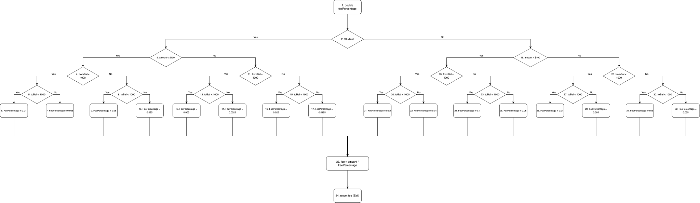

# CS4472 - Assignment 2: White Box Testing

## 1. Withdrawal

### 1.1 Process and Assumptions

### 1.2 Analysis Artifact: Slice

### 1.3 Test Cases

### 1.4 Test Results

### 1.5 Fault Localization

## 2. Deposit — DU-Path Testing

### 2.1 Process and Assumptions

### 2.2 Analysis Artifact: DU-Path Table

### 2.3 Test Cases

### 2.4 Test Results

### 2.5 Fault Localization

## 3. Transfer — Basis Path Testing

### 3.1 Process and Assumptions

Basis path testing was performed on the `calculateTransferFee` method in the `bank.utils.FeesCalculator` class.

The control-flow graph (CFG) was constructed by examining the existing Java implementation. Each decision and executable statement was assigned a unique node number, and conditional edges were labelled Yes or No to represent the outcome of each condition.

The cyclomatic complexity was calculated to determine the required number of independent basis paths. Each basis path was then identified by tracing a sequence of nodes from the method entry to the return statement.

Test inputs were selected to satisfy the conditions along each basis path. Parameterized JUnit tests were implemented in `TransferFeeTest.java` to execute and evaluate each test case independently.

**Assumptions:**

- The CFG represents the existing implementation, including any potential faults.
- Node 1 represents the method entry and variable declaration.
- Node 34 represents the method exit and return statement.
- `fromBal` represents `fromAccountBalance`.
- `toBal` represents `toAccountBalance`.
- Each basis path begins at node 1 and terminates at node 34.
- Test inputs are selected to execute the corresponding basis path in the implementation.
- Expected fees are calculated independently using the Assignment 2 business logic specification.
- The method is tested directly without mocking external dependencies.
- Representative values are selected above and below the decision thresholds.
- Fees are not rounded to the nearest cent because the specification does not require rounding.
- A tolerance of 0.0001 is used when comparing expected and actual fees to account for floating-point precision.

### 3.2 Analysis Artifact: Control-Flow Graph and Basis Paths

#### Control-Flow Graph

#### Cyclomatic Complexity

The cyclomatic complexity is calculated using:

$$V(G) = E - N + 2$$

where:

- Number of edges (E) = 48
- Number of nodes (N) = 34

Therefore:

$$V(G) = 48 - 34 + 2 = 16$$

This result can also be verified using the number of decision nodes (D):

$$V(G) = D + 1$$

$$V(G) = 15 + 1 = 16$$

Therefore, 16 independent basis paths are required.

#### Basis Paths — Student

| Path ID | Node Sequence |
|---|---|
| P1 | 1 → 2 → 3 → 4 → 5 → 6 → 33 → 34 |
| P2 | 1 → 2 → 3 → 4 → 5 → 7 → 33 → 34 |
| P3 | 1 → 2 → 3 → 4 → 8 → 9 → 33 → 34 |
| P4 | 1 → 2 → 3 → 4 → 8 → 10 → 33 → 34 |
| P5 | 1 → 2 → 3 → 11 → 12 → 13 → 33 → 34 |
| P6 | 1 → 2 → 3 → 11 → 12 → 14 → 33 → 34 |
| P7 | 1 → 2 → 3 → 11 → 15 → 16 → 33 → 34 |
| P8 | 1 → 2 → 3 → 11 → 15 → 17 → 33 → 34 |

#### Basis Paths — Non-Student

| Path ID | Node Sequence |
|---|---|
| P9 | 1 → 2 → 18 → 19 → 20 → 21 → 33 → 34 |
| P10 | 1 → 2 → 18 → 19 → 20 → 22 → 33 → 34 |
| P11 | 1 → 2 → 18 → 19 → 23 → 24 → 33 → 34 |
| P12 | 1 → 2 → 18 → 19 → 23 → 25 → 33 → 34 |
| P13 | 1 → 2 → 18 → 26 → 27 → 28 → 33 → 34 |
| P14 | 1 → 2 → 18 → 26 → 27 → 29 → 33 → 34 |
| P15 | 1 → 2 → 18 → 26 → 30 → 31 → 33 → 34 |
| P16 | 1 → 2 → 18 → 26 → 30 → 32 → 33 → 34 |

#### Basis Path Independence

Each identified basis path introduces at least one edge not traversed by any preceding path. Specifically, each path traverses a unique fee percentage assignment node.

The number of independent paths equals the cyclomatic complexity of the CFG, V(G) = 16. Together, these paths cover all nodes and edges of the CFG.

### 3.3 Test Cases

Test cases are derived from the basis paths identified in Section 3.2. Inputs are selected to satisfy the conditions along each corresponding path.

Transfer amounts of $50 and $200 are used to represent values below and above the $100 threshold. Account balances of $500 and $2,000 are used to represent values below and above the $1,000 threshold.

Expected fees are calculated using the Assignment 2 business logic specification:

$$\text{Expected Fee} = \text{Amount} \times \frac{\text{Specified Fee Percentage}}{100}$$

#### Student Test Cases

| Test ID | Basis Path | Student | Amount ($) | From Balance ($) | To Balance ($) | Expected Rate | Expected Fee ($) |
|---|---|---|---|---|---|---|---|
| T1 | P1 | True | 50 | 500 | 500 | 0.1% | 0.05 |
| T2 | P2 | True | 50 | 500 | 2000 | 0.05% | 0.025 |
| T3 | P3 | True | 50 | 2000 | 500 | 0.5% | 0.25 |
| T4 | P4 | True | 50 | 2000 | 2000 | 0.25% | 0.125 |
| T5 | P5 | True | 200 | 500 | 500 | 0.05% | 0.10 |
| T6 | P6 | True | 200 | 500 | 2000 | 0.025% | 0.05 |
| T7 | P7 | True | 200 | 2000 | 500 | 0.25% | 0.50 |
| T8 | P8 | True | 200 | 2000 | 2000 | 0.125% | 0.25 |

#### Non-Student Test Cases

| Test ID | Basis Path | Student | Amount ($) | From Balance ($) | To Balance ($) | Expected Rate | Expected Fee ($) |
|---|---|---|---|---|---|---|---|
| T9 | P9 | False | 50 | 500 | 500 | 0.2% | 0.10 |
| T10 | P10 | False | 50 | 500 | 2000 | 0.1% | 0.05 |
| T11 | P11 | False | 50 | 2000 | 500 | 1% | 0.50 |
| T12 | P12 | False | 50 | 2000 | 2000 | 0.5% | 0.25 |
| T13 | P13 | False | 200 | 500 | 500 | 0.1% | 0.20 |
| T14 | P14 | False | 200 | 500 | 2000 | 0.05% | 0.10 |
| T15 | P15 | False | 200 | 2000 | 500 | 0.5% | 1.00 |
| T16 | P16 | False | 200 | 2000 | 2000 | 0.25% | 0.50 |

#### JUnit Implementation

The transfer test cases are implemented in:

`src/test/java/bank/utils/TransferFeeTest.java`

Parameterized JUnit tests are used to execute each basis path independently. The `@CsvSource` annotation supplies the input parameters and expected fee for each test case.

Each test invokes `calculateTransferFee` directly and compares the returned fee against the expected fee using `assertEquals` with a tolerance of 0.0001.

The basis path identifier is included in the test name and assertion message to maintain traceability between the CFG, basis path table, test-case table and test results.

### 3.4 Test Results

The test cases are executed as parameterized JUnit tests against the existing implementation of `calculateTransferFee`.

Each test case passes if the actual fee matches the expected fee within the specified tolerance and fails otherwise.

#### Student Test Results

| Test ID | Basis Path | Expected Fee ($) | Actual Fee ($) | Result |
|---|---|---|---|---|
| T1 | P1 | 0.05 | 0.50 | Fail |
| T2 | P2 | 0.025 | 0.25 | Fail |
| T3 | P3 | 0.25 | 2.50 | Fail |
| T4 | P4 | 0.125 | 1.25 | Fail |
| T5 | P5 | 0.10 | 1.00 | Fail |
| T6 | P6 | 0.05 | 0.50 | Fail |
| T7 | P7 | 0.50 | 5.00 | Fail |
| T8 | P8 | 0.25 | 2.50 | Fail |

All eight student test cases were executed locally on November 25, 2026. All eight failed, with no execution errors. In each case, the actual fee was ten times the expected fee.

#### Non-Student Test Results

| Test ID | Basis Path | Expected Fee ($) | Actual Fee ($) | Result |
|---|---|---|---|---|
| T9 | P9 | 0.10 | 1.00 | Fail |
| T10 | P10 | 0.05 | 0.50 | Fail |
| T11 | P11 | 0.50 | 5.00 | Fail |
| T12 | P12 | 0.25 | 2.50 | Fail |
| T13 | P13 | 0.20 | 2.00 | Fail |
| T14 | P14 | 0.10 | 1.00 | Fail |
| T15 | P15 | 1.00 | 10.00 | Fail |
| T16 | P16 | 0.50 | 11.00 | Fail |

All eight non-student test cases also failed locally. T9–T15 returned ten times the expected fee, and T16 returned 22 times the expected fee.

#### Test Summary

| Metric | Student | Non-Student | Total |
|---|---|---|---|
| Planned test cases | 8 | 8 | 16 |
| Tests executed | 8 | 8 | 16 |
| Tests passed | 0 | 0 | 0 |
| Tests failed | 8 | 8 | 16 |
| Execution errors | 0 | 0 | 0 |

#### JaCoCo Coverage

The selected basis paths achieve theoretical 100% node and edge coverage of the transfer CFG, covering all 34 nodes and 48 edges.

The JaCoCo coverage report generated by the CI workflow reported the following:

| Coverage Metric | Result |
|---|---|
| Overall Project Coverage (JaCoCo) | 7.2% |
| Transfer Node Coverage (Theoretical) | 100% |
| Transfer Edge Coverage (Theoretical) | 100% |

The CI coverage summary reports project-level coverage and does not provide individual method-level coverage statistics for `calculateTransferFee`.

### 3.5 Fault Localization

All 16 transfer test cases failed. T1–T15 returned fees ten times the expected fee, while T16 returned a fee 22 times the expected fee.

The faults were localized to the fee percentage assignment statements.

| Fault ID | Failed Test Cases | Class | Method | Faulty Statement or Condition | Justification |
|---|---|---|---|---|---|
| TR-F1 | T1–T15 | FeesCalculator | calculateTransferFee | Fee percentage assignments at nodes 6, 7, 9, 10, 13, 14, 16, 17, 21, 22, 24, 25, 28, 29 and 31 | The assigned multipliers are ten times the values required by the specification. |
| TR-F2 | T16 | FeesCalculator | calculateTransferFee | Node 32: feePercentage = 0.055 | The assigned multiplier is 0.055 instead of 0.0025, resulting in a fee 22 times greater than expected. |

#### Incorrect Fee Multipliers

| Test Case | CFG Node | Implemented Multiplier | Expected Multiplier |
|---|---|---|---|
| T1 | 6 | 0.01 | 0.001 |
| T2 | 7 | 0.005 | 0.0005 |
| T3 | 9 | 0.05 | 0.005 |
| T4 | 10 | 0.025 | 0.0025 |
| T5 | 13 | 0.005 | 0.0005 |
| T6 | 14 | 0.0025 | 0.00025 |
| T7 | 16 | 0.025 | 0.0025 |
| T8 | 17 | 0.0125 | 0.00125 |
| T9 | 21 | 0.02 | 0.002 |
| T10 | 22 | 0.01 | 0.001 |
| T11 | 24 | 0.1 | 0.01 |
| T12 | 25 | 0.05 | 0.005 |
| T13 | 28 | 0.01 | 0.001 |
| T14 | 29 | 0.005 | 0.0005 |
| T15 | 31 | 0.05 | 0.005 |
| T16 | 32 | 0.055 | 0.0025 |

The first 15 incorrect assignments are grouped by their common factor-of-ten discrepancy. Node 32 is listed separately because its multiplier differs from the specification by a factor of 22. The grouping describes the observed fault patterns; each affected assignment is identified separately.

No modifications are made to the original implementation.
